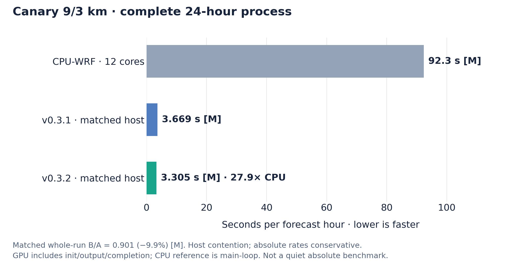
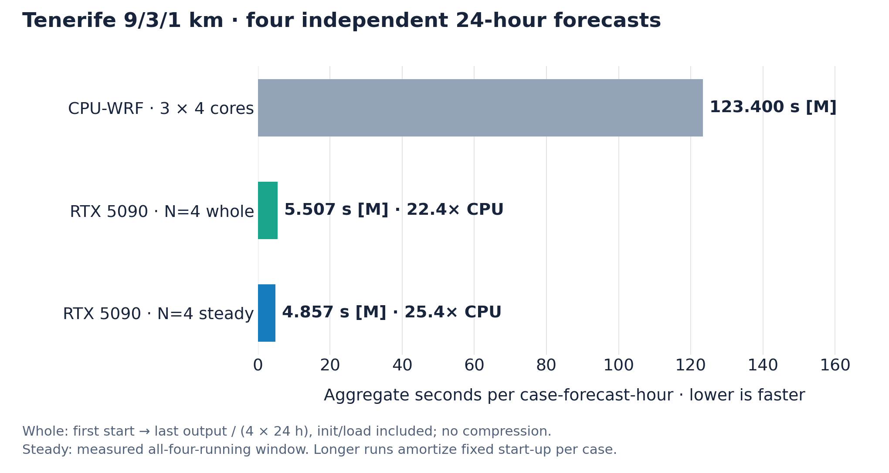
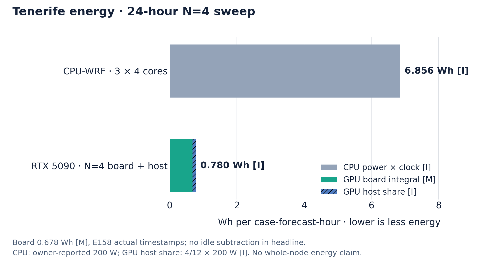
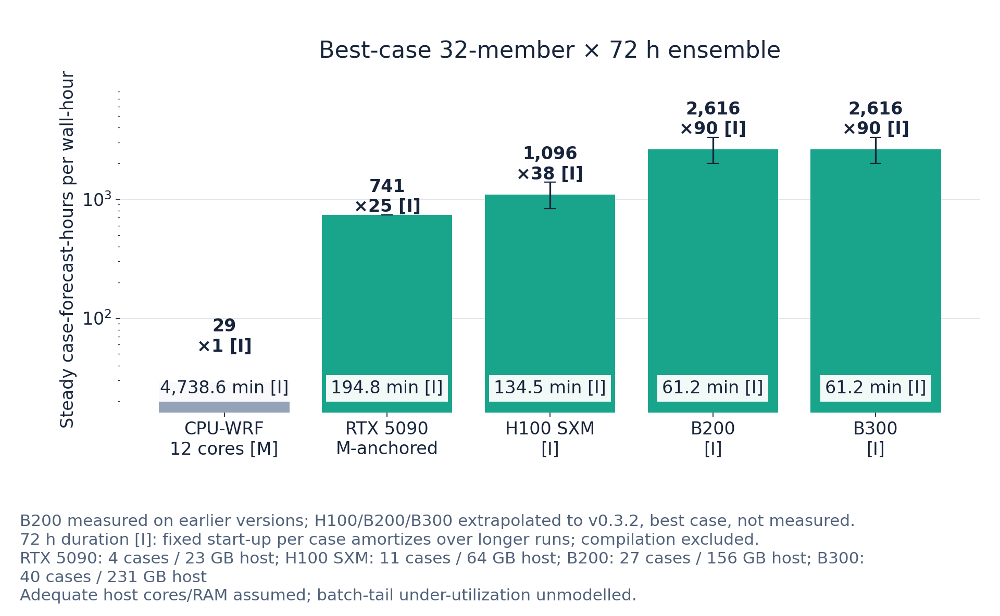
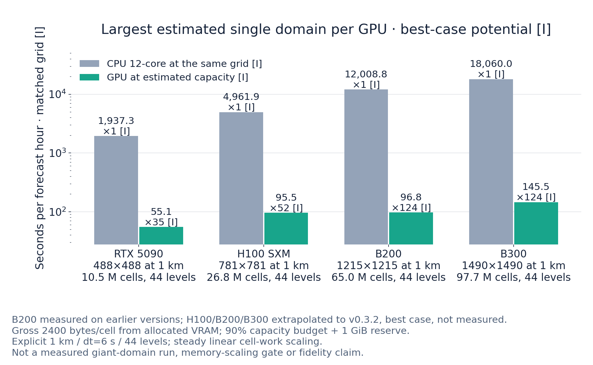

# wrf_gpu

[](release_notes/RELEASE_NOTES_v0.5.0.md)
[](LICENSE)
[](https://wrf-gpu.github.io/wrf_gpu/)
[](pyproject.toml)

**WRF-compatible regional weather forecasts on a single NVIDIA GPU, checked against the original Fortran WRF.**

`wrf_gpu` rewrites WRF v4 ARW dynamics and physics in JAX, XLA and Pallas.
It reads WPS/`real.exe` inputs and `namelist.input`, and writes WRF NetCDF
history for your existing tools. The goal is faster regional forecasting
with less energy per forecast hour.

v0.5.0 adds tools for many short, controlled experiments: surface variants
from one spin-up, stochastic physics in nests, land-use and terrain patches,
and evaluation output during the run. With these off, the forecast programs
equal v0.4.6. [Checks and
limits](release_notes/RELEASE_NOTES_v0.5.0.md).

[First forecast](#your-first-forecast-in-three-steps) ·
[User guide](https://wrf-gpu.github.io/wrf_gpu/) ·
[Published support matrix (v0.4.4)](docs/release/SUPPORT_MATRIX_v0.4.4.md) ·
[Validation](docs/release/VALIDATION_v0.4.0.md) ·
[Release notes](release_notes/RELEASE_NOTES_v0.5.0.md)

`wrf_gpu` is an independent project, not WRF itself, and is not affiliated
with or endorsed by UCAR/NCAR.

## What's new in v0.5.0

Released 13 November 2026; new options are off by default.

- **Branch series:** spin up once, then run many surface variants from that checkpoint without recompiling ([guide](docs/checkpoint-branching.md#branch-series-many-value-variants-from-one-spin-up)).
- **Stochastic physics in nests** (SKEBS, SPPT, SPP) as in WRF, checked against CPU-WRF ([guide](docs/stochastic.md)).
- **Checked patches** for land use, roughness and terrain ([guide](docs/static_patch.md)).
- **Evaluation files during the run**, optionally without history ([guide](docs/extract.md)), and WRF's AFWA 10 m wind maximum ([guide](docs/ONLINE_DIAGNOSTICS.md#afwa-severe-10-m-maximum-wind-wspd10max)).
- **Three nine-nest members per GPU** give 1.6× the throughput of one ([numbers](docs/ensemble.md#several-members-on-one-gpu-measured-with-v050-development-code)).

[Release notes](release_notes/RELEASE_NOTES_v0.5.0.md) · [Known issues](KNOWN_ISSUES.md)

## Tune WRF for your region: inverse modelling

The RE-Toolkit tests whether local surface or physics settings move simulated
wind and temperature toward your observations. Ensemble Kalman inversion
updates land-class surface multipliers within your bounds; changing these
values reuses the compiled programs.

Surface controls have Swiss GPU/CPU-WRF response checks; the inverse estimator
has **synthetic-twin tests only**. Real-station calibration and forecast
improvement are unproven. Hold out dates and stations: forcing or sampling
errors can mimic parameter errors.
[Workflow and limits](docs/regional_optimization.md#continuous-parameters-experimental) ·
[Surface-control evidence](docs/surface_params.md#ensemble-kalman-inversion-scaffold-synthetic-tests-only-in-v041)

## Your first forecast in three steps

1. **Install** `wrf_gpu` with pip ([details](#install)), or build the
   [onboarding container](docs/onboarding.md#install-the-container), which also
   builds the original WPS and WRF tools and the GPU software for you.
2. **Run the bundled example**, a 24-hour forecast over the Swiss Alps whose
   inputs ship with the repository ([Quickstart](#quickstart)).
3. **Make a forecast for your own region.** Give a bounding box, a grid
   spacing and a start time. `gpuwrf quickstart` downloads open NOAA GFS data,
   runs WPS and `real.exe` for you and then starts the GPU forecast:

```bash
gpuwrf quickstart --profiles     # how large a grid fits on a 12-32 GB GPU
gpuwrf quickstart --bbox -17 28 -16 28.6 --resolution-km 9 \
  --date 2026-10-12T00 --hours 3 --case-dir work/tenerife --run
```

Use a recent GFS cycle. The [region guide](docs/onboarding.md) covers the
container and geography data. Estimated grids with 44 levels: about
276 × 276 points on 12 GB, or 496 × 496 on 32 GB. Region set-up is
experimental: preparation is tested on three areas; forecasts for new regions
have not been compared with CPU-WRF.

## Why wrf_gpu

- **Fast.** Regional benchmarks and matched version timings are shown below.
- **Faithful to WRF.** Every release is compared field by field with the
  original Fortran WRF run from the same inputs, against limits fixed in
  advance.
- **Fits your WRF workflow.** Same inputs, same namelist, same output format.
  Fixed nests, checkpoint and restart are supported.
- **Broad physics.** More than 80 WRF physics options run on the GPU,
  including the common operational suites.
- **Many forecasts per card.** A memory-aware launcher runs ensembles and
  independent cases side by side on one GPU.
- **Tune your region.** Compare with stations, try surface parameters and
  physics choices, and check the result on held-out dates.

## Speed and energy

Measured on an **RTX 5090** with a **Ryzen 9 9950X** host. A fair version
comparison uses the same case, session and timing window. Stepping excludes
startup; time to the last output includes it.

**v0.4.6:** stepping N/O 1.0020, S=0.0416, upper bound 1.0436<1.10: no
resolved speed change. VRAM 0.9959×; RSS 1.0003×. Cold-minus-warm compile
proxy: 473.13 versus 489.90 s, separate from forecast speed.

| Same-session comparison | Earlier version | Later version | What it shows |
|---|---:|---:|---|
| Tenerife 9/3/1 km, three 24-hour pairs, stepping | v0.4.5: 5.7870 s per forecast hour | v0.4.6: 5.7987 s | N/O 1.0020; upper 1.0436; no resolved speed change |
| Same Tenerife pairs, process start to last output | v0.4.5: 6.9017 s per forecast hour | v0.4.6: 6.9484 s | N/O 1.0068; whole-run statistic |
| Tenerife 9/3/1 km, two 24-hour pairs, stepping | v0.4.4: 5.7625 s per forecast hour | v0.4.5: 5.7425 s | N/O 0.9965; upper 1.0146; no resolved speed change |
| Same Tenerife pairs, process start to last output | v0.4.4: 6.8102 s per forecast hour | v0.4.5: 6.8593 s | N/O 1.0072; whole-run statistic |
| Canary Islands 9/3 km, 3-hour probe, stepping | v0.3.2: 2.904 s per forecast hour | v0.4.3: 3.131 s | Inconclusive: v0.3.2 repeat spread 8.71% exceeded the 5% noise limit |
| Tenerife 9/3/1 km, three 24-hour pairs, stepping | v0.4.3: 5.920 s per forecast hour | v0.4.4: 5.911 s | No resolved speed change; repeat spread 2.79% |

The old 3.3- and 4.8-second whole-run figures used different memory allocation
and shared-host conditions; their gap is not a measured version regression.
The old-version 72-hour arm did not run. The v0.4.5 comparison uses **two fresh
same-session 24-hour pairs**; the earlier v0.4.4 comparison used three pairs.
[Methods and measurements](release_notes/RELEASE_NOTES_v0.4.4.md#matched-release-day-speed-and-memory).

**Historical v0.3.2 benchmarks.** These plots and table retain their original
cases and conditions. They are not v0.4.5 measurements or direct version
comparisons. GPU times include startup and output from a warm cache; CPU-WRF
counts its main loop.

<picture><source media="(prefers-color-scheme: dark)" srcset="docs/release/img/v032_speed_dark.png"></picture>

Four three-domain Tenerife forecasts shared the card:

<picture><source media="(prefers-color-scheme: dark)" srcset="docs/release/img/v032_parallel_dark.png"></picture>

| Historical v0.3.2 workload | CPU-WRF | RTX 5090 | Ratio |
|---|---:|---:|---:|
| Canary Islands 9/3 km, 24 h, one forecast | 92.3 s per forecast hour (12 cores) | **3.3 s** | **28×** |
| Tenerife 9/3/1 km, four forecasts in parallel | 123.4 s per case-hour (3 × 4 cores) | **5.5 s** | **22×** |
| Energy, same four forecasts | about 6.9 Wh per case-hour (estimate) | **0.78 Wh** | **about 9× less** |

GPU energy combines measured board power and an estimated host share; CPU
energy assumes 200 W. No whole-machine power meter was used.

<picture><source media="(prefers-color-scheme: dark)" srcset="docs/release/img/v032_energy_dark.png"></picture>

[Original measurement report](docs/release/V0.3.2.md).

<details>
<summary><b>Scaling outlook (estimates, not measurements)</b></summary>

Historical extrapolations use v0.3.2 anchors; H100, B200 and B300 remain untested.

<picture><source media="(prefers-color-scheme: dark)" srcset="docs/release/img/v032_best_case_ensemble_dark.png"></picture>

<picture><source media="(prefers-color-scheme: dark)" srcset="docs/release/img/v032_best_case_giant_domain_dark.png"></picture>

[Scaling method and assumptions](docs/release/V032_BEST_CASE_SCALING.md).

</details>

## Physics on the GPU

Options run at their documented scope; see the support matrix.

| Physics | Options running on the GPU | Default |
|---|---|---|
| Microphysics | 31 schemes: Kessler, Lin, WSM3–7, WDM5–7, Thompson (also aerosol-aware and hail), Morrison, Milbrandt–Yau, NSSL, Ferrier, Goddard, P3, CAM, Jensen–ISHMAEL, NTU and more | Thompson |
| Cumulus | 15: Kain–Fritsch family, Betts–Miller–Janjić, Grell–Freitas, Grell 3D, Grell–Devenyi, Tiedtke, SAS family, Zhang–McFarlane | Kain–Fritsch (coarse domains) |
| Boundary layer | 14: YSU, MYJ, MYNN, ACM2, QNSE, BouLac, Shin–Hong, TEMF, UW and more | MYNN |
| Surface layer | 8 | MYNN |
| Land and water | Noah-MP with its main options, RUC, SSiB; lake, urban canopy and ocean mixed-layer models | Noah-MP |
| Radiation | RRTMG (with aerosol and scale-aware cloud fraction), RRTM, CAM, Goddard, Dudhia | RRTMG |

Every option in the table ran in at least one 24-hour GPU forecast compared
with CPU-WRF (Goddard radiation: six hours). Not every combination or option
inside nested domains is covered, and many non-default options are not yet
tuned for speed. The
[support matrix](docs/release/SUPPORT_MATRIX_v0.4.4.md) gives the status of
each option. Unsupported choices stop before the run with a clear reason.

## How we check it against WRF

We compare original Fortran WRF and `wrf_gpu` from identical inputs, checking
every hourly field over the whole grid. Limits are fixed beforehand and
never loosened afterwards: root-mean-square differences of 1.5 K for 2 m
temperature, 120 Pa for surface pressure and 1 mm for accumulated rain.
Grid and terrain fields must match exactly.

<picture><source media="(prefers-color-scheme: dark)" srcset="docs/release/v040_figures/readme_validation_dark.png"></picture>

In this 24-hour, three-domain Tenerife forecast, every field stays below a
quarter of its limit; 2 m temperature differs by at most 0.09 K.

For v0.4.0 this check passed on **66 different physics configurations**, and
the default physics passed on five real cases over the Canary Islands and the
Swiss Alps. The comparisons also found real bugs: an error in how the Tiedtke
cumulus scheme was called made the accumulated-rain difference peak at 1.1 mm;
after the fix it peaks at 0.03 mm.

From v0.4.1 on, every release is also
[checked the way operational users run it](release_notes/RELEASE_NOTES_v0.4.1.md#appendix-real-world-release-checks):
from a warm compile cache, on a new forecast date with longer input files, as
a 72-hour three-domain forecast compared with CPU-WRF, and from the release
bundle on several dates.

Results are close to WRF, not bit-identical. GPUs round floating-point
arithmetic differently, and weather is chaotic, so small differences grow
with forecast length. In our 72-hour comparisons most late differences are
about as large as those between two CPU-WRF runs started from slightly
different conditions. The [validation page](docs/release/VALIDATION_v0.4.0.md)
has every result, including the cases that exceed the limits late in long
runs.

## Install

You need an NVIDIA Ampere or newer GPU (compute capability 8.0+), a CUDA 13
driver, Python 3.11+ and WRF v4 runtime tables. Testing used an RTX 5090;
the three-domain Tenerife v0.3.2 benchmark used about 5 GB of GPU memory.

```bash
git clone https://github.com/wrf-gpu/wrf_gpu.git
cd wrf_gpu
pip install "jax[cuda13]==0.10.*"
pip install -e .
export GPUWRF_WRF_ROOT=/path/to/WRF   # directory with WRF's run/ tables
```

Large microphysics lookup tables, including the Thompson tables the
quickstart needs, are downloaded on first use from the GitHub release and
checked against pinned checksums.

The [installation guide](https://wrf-gpu.github.io/wrf_gpu/installation.html)
covers optional dependencies and offline table caches.

## Quickstart

The repository ships a small 3 km case over the Swiss Alps (15 January 2023)
with Thompson, RRTMG, MYNN and Noah-MP physics:

```bash
gpuwrf doctor examples/switzerland_d01
gpuwrf run --input-dir examples/switzerland_d01 \
  --output-dir runs/switzerland --domain d01 --hours 24 \
  --scratch-dir runs/switzerland_scratch
```

The first run compiles for several minutes; later runs reuse the programs.
Open `runs/switzerland` NetCDF history with xarray, ncview or your usual
tools. The [example page](examples/switzerland_d01/README.md) compares it
with original CPU-WRF.

## Run your own case

Bring `namelist.input`, `wrfinput_d0*` and `wrfbdy_d01` from your usual WPS
and `real.exe` workflow, or let `gpuwrf quickstart` prepare them (step 3
above). For fixed nests, let the namelist decide the domains:

```bash
gpuwrf doctor /path/to/case
gpuwrf run --input-dir /path/to/case --output-dir runs/my_case \
  --domains-from-namelist --hours 24
```

Independent cases can share the card. The launcher checks GPU and host memory
and queues the rest:

```bash
scripts/run_parallel_cases.sh --out-root runs/batch CASE_A CASE_B CASE_C -- \
  --domains-from-namelist --hours 24
```

Single and nested runs can checkpoint and resume. The
[existing command guide](docs/release/USER_GUIDE_v0.4.3.md) covers restart, ensembles,
products and verification. AI assistants can follow [AI_OPERATOR.md](AI_OPERATOR.md).

## How it works

The model retains WRF's Runge–Kutta and acoustic time stepping, staggered
Arakawa C grid and column physics. JAX traces each grid and physics selection,
XLA compiles for the GPU, and Pallas kernels handle hot spots.

Precision follows WRF: like the standard WRF build, the model works in single
precision. Double precision is retained where WRF needs it and in small
reviewed clock-division islands that round back to single precision.
The forecast state stays on the GPU for the whole run; output is written in
the background. A [profile of where the GPU time goes](docs/release/S4_ENDPOINT_RC3.md)
shows the largest parts of a time step.

## Limitations

- One forecast runs on one GPU. Several forecasts can share a GPU; splitting
  one domain over several GPUs is [experimental](docs/MULTI_GPU.md) and not
  yet benchmarked.
- Not every WRF option or combination is supported. Moving nests, adaptive
  time steps, WRF-Chem, fire and hydrology coupling are refused with a named
  reason.
- Results match WRF closely but not bit for bit, and differences grow with
  forecast length.
- The first run of a new grid or physics selection compiles for several
  minutes and needs more host memory.
- Older NVIDIA and AMD GPUs are compile-checked only, not validated
  ([details](release_notes/RELEASE_NOTES_v0.5.0.md#portability-compile-checked-not-validated)).
- Heavy rain can differ from CPU-WRF in long forecasts: one 72-hour case has
  about 12–15 % fewer heavy-rain cells on days 2 and 3
  ([under investigation](KNOWN_ISSUES.md#v042-heavy-rain-cells-on-the-1-km-tenerife-domain)).

[Known issues](KNOWN_ISSUES.md) lists the open items in detail.

## Release history

| Version | Highlights |
|---|---|
| v0.5.0 | Experiment toolkit: branch series, stochastic physics in nests, patches, in-run evaluation output, AFWA wind maximum |
| v0.4.6 | WRF emissivity initialization and graupel entry mass; disclosed trace |
| v0.4.4 | Initialization/clock fixes, nested shading, experimental MYNN coefficients; 72-hour gate passes with disclosed exceptions |
| v0.4.3 | The v0.4.2 model with identical compiled programs, a three-nest qualification table, answers to user reports, host-suspend detection |
| v0.4.2 | Shortwave fix confirmed against WRF, faster WDM6, four boundary layers validated inside nests, radiation without clouds |
| v0.4.0 | More than 80 WRF 4.7.1 physics options, nudging, two-way nesting, stochastic physics, ensembles and forecast tools; 66 configurations checked against CPU-WRF |
| v0.3.2 | Historical speed and energy measurements shown above |

Older versions and every change are in the [changelog](CHANGELOG.md) and the
[release notes](release_notes/README.md).

## Citing

If you use `wrf_gpu` in your work, please cite the software and WRF itself:

```bibtex
@software{wrf_gpu,
  title   = {wrf_gpu: a GPU rewrite of the WRF ARW model in JAX},
  author  = {{wrf_gpu contributors}},
  year    = {2026},
  version = {0.5.0},
  url     = {https://github.com/wrf-gpu/wrf_gpu}
}
```

Skamarock, W. C., and co-authors, 2019: *A Description of the Advanced
Research WRF Model Version 4.* NCAR Technical Note NCAR/TN-556+STR,
doi:10.5065/1dfh-6p97.

## Get involved

Questions, bug reports and ideas are welcome as
[GitHub issues](https://github.com/wrf-gpu/wrf_gpu/issues). Please include
your namelist, where the inputs came from, the version and the output
cadence. Independent validation on your own cases is especially valuable.
Start with [CONTRIBUTING.md](CONTRIBUTING.md); changes to the numerics need a
comparison with CPU-WRF, and speed-ups need matched timings.

## License

The project's own code is released under the [MIT License](LICENSE). Some
files keep their upstream terms: AER's RRTMG/RRTM code and data may not be
sold; NCAR MMM physics translations carry NCAR's BSD 3-Clause notice;
WRF-derived material carries the UCAR public-domain notice. See
[THIRD_PARTY_NOTICES.md](THIRD_PARTY_NOTICES.md). WRF® is a registered
trademark of UCAR.
